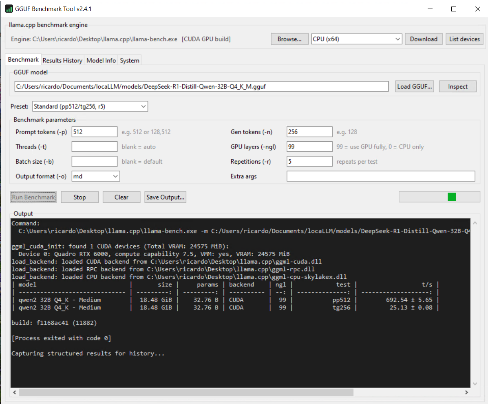

# GGUF Benchmark Tool v2.4.1

> New to the app? Read the **[User Manual](USER_MANUAL.md)** for a full,
> plain-language walkthrough.

A standalone Windows application to load a **GGUF** model file and benchmark it
using **llama.cpp**'s `llama-bench`.



## Features

- **Load & inspect GGUF** — pick a `.gguf` file and read its header to show
  architecture, quantization mix, context length, layers, attention heads,
  tensor count, and more (no model load, no dependencies).
- **Benchmark parameters** — prompt tokens, generation tokens, threads, GPU
  layers, batch size, repetitions, output format, and free-form extra args.
- **Quick-start presets** — Quick, Standard, Prompt sweep, Generation only,
  Context stress.
- **Live output** — streams `llama-bench` output into a console as it runs,
  with Stop, Clear, and Save.
- **GPU-aware engine download** — fetch the official llama.cpp **CPU**,
  **CUDA (newest or 12.x)**, **Vulkan**, **SYCL**, or **ROCm** (x64) Windows
  build straight from GitHub, or browse to your own `llama-bench.exe`. For CUDA,
  the matching CUDA runtime (cudart) is downloaded automatically. Download shows
  live progress and gives clear, actionable messages if a backend isn't
  available.
- **Smart failure handling** — if a run fails or crashes (e.g. a CUDA
  driver/toolchain mismatch, out-of-memory, or a bad model), the app detects it,
  stops instead of blindly re-running, and prints a plain-language explanation
  with specific fixes.
- **List devices** — show the compute devices the engine can see
  (`--list-devices`).
- **Results history** — every run is parsed and stored (tokens/s, stddev, test,
  params, ngl, model, timestamp), persisted across sessions, with delete,
  clear, and CSV export.
- **System info** — detects CPU, physical/logical cores, RAM, and GPUs
  (NVIDIA via `nvidia-smi`, plus AMD/Intel via Windows).

## Project layout

| File                 | Purpose                                             |
|----------------------|-----------------------------------------------------|
| `gguf_benchmark.py`  | Main tabbed GUI application                         |
| `gguf_reader.py`     | Pure-stdlib GGUF header/metadata parser             |
| `system_info.py`     | CPU / RAM / GPU detection                           |
| `make_icon.py`       | Generates `icon.ico` / `icon.png` (no Pillow)       |
| `build.bat`          | PyInstaller one-file build script                   |
| `requirements.txt`   | Build dependency (PyInstaller)                      |

## Getting the benchmark engine

The app does **not** bundle the llama.cpp binaries — they are large and specific
to your backend (CPU, CUDA, Vulkan) and are released separately by
[ggml-org/llama.cpp](https://github.com/ggml-org/llama.cpp/releases).

It finds `llama-bench.exe` in this order:

1. A path you set previously (saved in `gguf_benchmark_config.json`).
2. Next to the exe, or in a `llama.cpp\` / `bin\` subfolder beside it.
3. On your system `PATH`.

If none is found, pick a backend in the top bar and click **Download**, or use
**Browse...** to point at an existing `llama-bench.exe`.

> The app scans the llama.cpp releases list and uses the newest `bXXXXX` tag
> that actually ships a Windows build. (GitHub's "latest" release is a tooling
> tag with no binaries, so it is intentionally skipped.)

> GPU builds require a compatible GPU and drivers. For GPU runs set
> **GPU layers (-ngl)** to `99` (offload all) or a specific count. CUDA builds
> also need the CUDA runtime, which the app fetches for you; if a run fails with
> a missing `cudart`/`cublas` DLL, install the NVIDIA CUDA Toolkit.

### CUDA "unsupported toolchain" error

If a CUDA run crashes with:

```
CUDA error: the provided PTX was compiled with an unsupported toolchain.
```

the CUDA build is newer than your NVIDIA driver supports. Fixes, easiest first:

1. Pick **CUDA 12.x (older drivers, x64)** in the engine bar and **Download** —
   it matches older drivers and usually resolves this exact error.
2. Update your NVIDIA driver and retry the newest CUDA build.
3. Switch to the **Vulkan** backend (runs on the same GPU, no CUDA toolchain).
4. Fall back to a CPU build with **GPU layers (-ngl) = 0**.

The app now detects this automatically and prints these steps when it happens.

## Running from source

```bat
python gguf_benchmark.py
```

Only the Python standard library is required to run (tkinter ships with CPython
on Windows).

## Building the exe

```bat
build.bat
```

Produces `dist\GGUFBenchmark_v2.4.1.exe` — a single-file, windowed executable
with the app icon embedded.

## Benchmark parameters

| Field              | llama-bench flag | Notes                                   |
|--------------------|------------------|-----------------------------------------|
| Prompt tokens      | `-p`             | e.g. `512` or `128,512`                 |
| Gen tokens         | `-n`             | e.g. `128`                              |
| Threads            | `-t`             | blank = auto                            |
| GPU layers         | `-ngl`           | `0` = CPU only, `99` = all              |
| Batch size         | `-b`             | blank = default                         |
| Repetitions        | `-r`             | repeats per test                        |
| Output format      | `-o`             | md / csv / json / jsonl / sql           |
| Extra args         | (raw)            | any additional `llama-bench` flags      |

## Notes

- For history capture, when you pick a human-readable format (`md`/`csv`/`sql`)
  the app does one visible run in that format, then a second quick run in JSON
  to record structured numbers. Pick `json`/`jsonl` to run only once.
- Config and history are stored next to the exe as
  `gguf_benchmark_config.json` and `gguf_benchmark_history.json`.

## Robustness

The app is hardened for everyday use:

- All benchmark inputs are validated before a command runs (clear messages for
  bad numbers, empty fields, or unparseable extra args).
- Worker threads can never leave the UI stuck "running" — the busy state is
  always released, even on an unexpected error.
- Config and history are written atomically, so an interrupted save can't
  corrupt them; a malformed history file is sanitized on load.
- The GGUF reader bounds all length/count fields against the file size, so a
  corrupt or hostile `.gguf` can't exhaust memory or hang.
- Engine downloads are restricted to GitHub HTTPS hosts and extracted with a
  path-traversal ("zip-slip") guard.
- Stopping or quitting terminates the whole engine process tree.

## Credits

© 2026 Created by **Ricardo de Koning**. MIT licensed.
